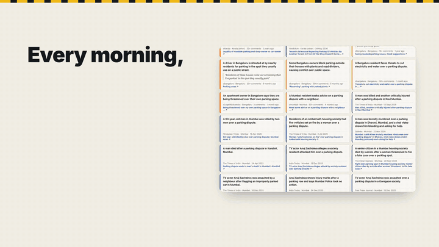
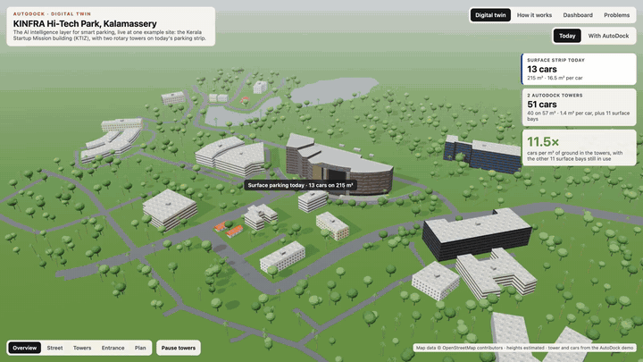
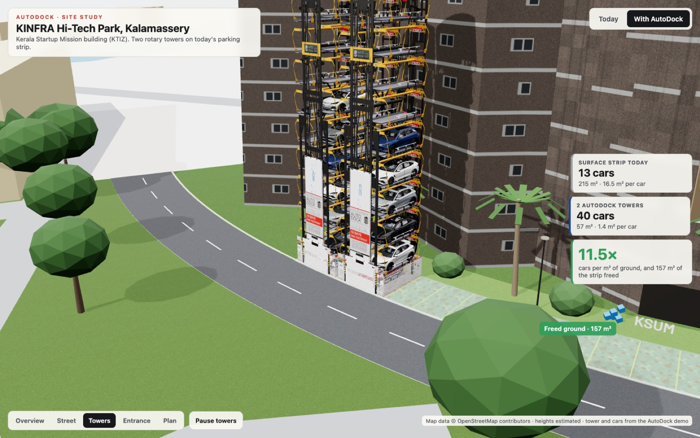
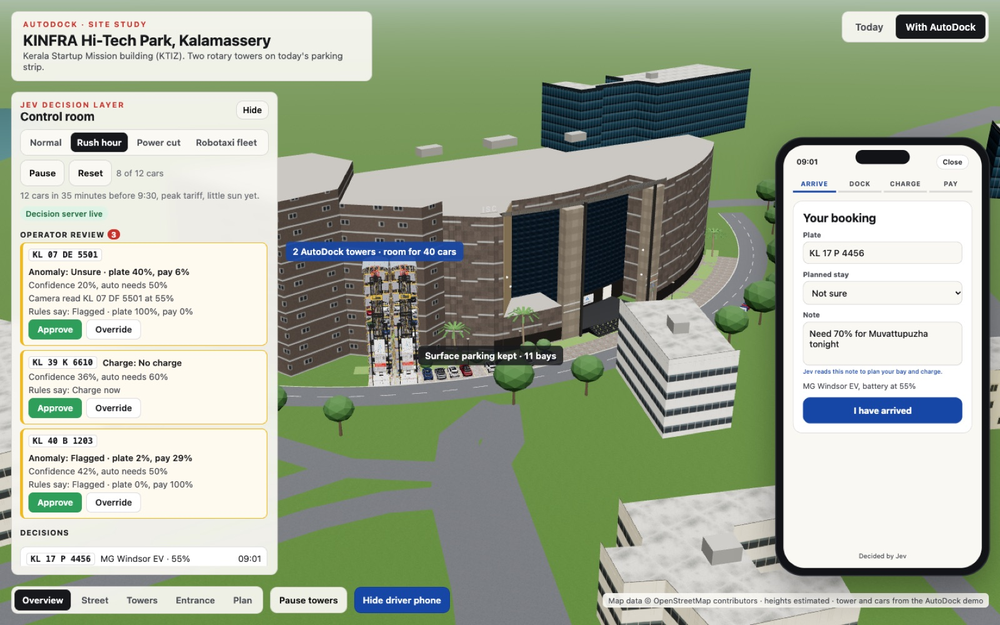

# AutoDock × Jev: a decision layer for rotary EV parking towers

> We are building the AI intelligence layer for smart parking, and for the
> autonomous parking infrastructure that comes next. It starts as the software
> brain for AutoDock's rotary parking and charging towers: 40 charging cars on 4
> of 15 surface bays, with every call made by Jev or, when Jev is unsure, by a
> person.

**[▶ Pitch film](docs/demo/pitch-film.mp4)** · **[Demo video](docs/demo/demo.mp4)** · **[Pitch deck](docs/pitch/deck.pdf)** · **[AI Impact Statement](docs/AI_IMPACT.md)** · **[Quick start](#setup-and-run)** · **[Licence](#licence)**

**AIBoomi Startup Weekend, 23–24 Oct 2026.** Kerala and India are running out
of parking and chargers: we collected 474 real complaints, 154 from Kerala and
the rest from Delhi NCR, Mumbai, Bengaluru and cities across India. AutoDock
rotary towers stack cars and charge them, and TypeSafe's **Jev** decides what
happens to every car, bay and kilowatt. Confident decisions act on their own;
uncertain ones go to a person. Our example site is a live 3D digital twin of the
Kerala Startup Mission building at KINFRA Hi-Tech Park, Kalamassery, where two
towers replace part of today's surface parking strip.

> [!NOTE]
> **Status: hackathon prototype.** Built in one weekend. The performance numbers
> come from a seeded simulation, not a real site; arrivals in the demo are
> scripted and payment is a mock. See [Known limitations and risks](#known-limitations-and-risks).

## Watch

Click a preview to open the full video with sound in GitHub's player.

| Pitch film (3 min 16 s, narrated) | Demo video (2 min, screen recording) |
|---|---|
| [](docs/demo/pitch-film.mp4) | [](docs/demo/demo.mp4) |
| [▶ Play the pitch film](docs/demo/pitch-film.mp4) | [▶ Play the demo video](docs/demo/demo.mp4) |

## At a glance

| | |
|---|---|
| **Problem** | 474 parking complaints: 154 in Kerala, 320 across the rest of India |
| **Example site** | KSUM building, KINFRA Hi-Tech Park, Kalamassery (digital twin, pilot candidate) |
| **Today** | 15 surface bays, full by mid-morning, no chargers |
| **With AutoDock** | 2 towers × 20 pallets on 4 bays (57 m²): 40 cars, a 7.4 kW AC charger in every bay |
| **Brain** | One Jev request per arriving car: bay, charge plan, price tier, plate and payment risk |
| **Rush hour, simulated** | Grid peak 60 → 42.6 kW, energy cost ₹2,989 → ₹2,262 |
| **Tests** | 52 unit tests, no live calls |

- **Pitch film:** [`docs/demo/pitch-film.mp4`](docs/demo/pitch-film.mp4) (3 min 16 s, narrated: the parking problem across Kerala and India from 474 complaints collected with SerpAPI, our solution (space and intelligence), KSUM as one example in a live digital twin, a driver's morning on the phone app, why Jev and not a chat model, how it decides, the results). Built from code in [`video/`](video) with HyperFrames and an ElevenLabs voice.
- **Demo video:** [`docs/demo/demo.mp4`](docs/demo/demo.mp4) (2 min, screen recording of the running app: twin, control room, dashboard and problems)
- **Pitch deck:** [`docs/pitch/deck.pdf`](docs/pitch/deck.pdf) (6 slides) · source [`docs/pitch/deck.html`](docs/pitch/deck.html)
- **AI Impact Statement:** [`docs/AI_IMPACT.md`](docs/AI_IMPACT.md)
- **Live demo:** run it locally in two commands (below). It needs a TypeSafe API key for live Jev decisions and falls back to rules without one.

## Contents

- [Setup and run](#setup-and-run)
- [Problem](#problem)
- [Users and context](#users-and-context)
- [Solution](#solution)
- [Evaluation and guardrails](#evaluation-and-guardrails)
- [Tech stack](#tech-stack)
- [Models and data](#models-and-data)
- [Assumptions and trade-offs](#assumptions-and-trade-offs)
- [Known limitations and risks](#known-limitations-and-risks)
- [Prior work and what was built here](#prior-work-and-what-was-built-here)
- [Repository map](#repository-map)
- [Team](#team)
- [Licence](#licence)

## Setup and run

**Prerequisites:** Node 22+ (we used 25) and Chrome or another WebGL browser.

```sh
git clone git@github.com:laanswork-code/autodockai-aiboomi.git
cd autodockai-aiboomi
cp .env.example .env              # add TYPESAFE_API_KEY (console.typesafe.ai)
cd ksum-3d && npm install
npm run server                    # Jev decision server on :8788 (key stays server side)
npm run dev                       # app on http://localhost:5173, proxies /api to the server
```

Open the app, choose **With AutoDock**, then **Rush hour** in the control room.
Two more pages: **`/dashboard`** monitors the decision layer live (Jev decisions, cost, latency,
confidence, escalations, the simulated comparison) and **`/problems`** lists the 474 parking
problems from the research, linked to the originals.

> [!TIP]
> No TypeSafe key? The app still runs: every decision falls back to the rules
> policy and the UI says so. On slow machines or for screenshots add `?lite` to
> the URL (no trees or shadows).

Other commands, run from `ksum-3d/`:

| Command | What it does |
|---|---|
| `npm test` | 52 tests, no live calls |
| `npm run sim -- --policy both --scenario all --seed 42` | Simulated comparison; replays cached Jev answers |
| `npm run build` | Production build |

Full details: [`ksum-3d/README.md`](ksum-3d/README.md).

## Problem

Kerala and the rest of India have more cars and EVs than parking or chargers,
and no spare land in their cities to add either. Parking and charging are two
separate errands, and robotaxi fleets will soon need unattended depots too.

**Our evidence:** [474 real complaints from Reddit, forums and news](research/site/index.html),
collected with SerpAPI during the event.

| Where | Complaints |
|---|---|
| Kerala (Kochi 55, Thiruvananthapuram 38, Kozhikode 22, Thrissur 7, rest of the state 32) | 154 |
| Delhi NCR · Mumbai · Bengaluru | 55 · 43 · 37 |
| Hyderabad · Chennai · Pune | 14 · 13 · 7 |
| Elsewhere in India | 151 |

The biggest groups: fights and disputes (111), EV charging (84), homes and
apartments (58), roadside parking and jams (57), fees (54) and drivers who
cannot find a spot (49).

**One example: KSUM, Kalamassery.** At the Kerala Startup Mission building, 15
surface bays fill by mid-morning with no chargers; drivers circle, park on the
road, or leave. It is the site we model as the digital twin and the pilot
candidate, one car park among many with the same problem.

## Users and context

The users are the same in any crowded car park in Kerala or the rest of India;
the KSUM building is our first example site.

| Who | What they get |
|---|---|
| **Site owners** (tech parks, malls, hospitals, apartment associations), starting with KSUM as the example site | More cars and chargers on the same land. |
| **Drivers** | One stop to park and charge, with a phone flow from arrival to UPI payment. |
| **Operators** | A control room that only interrupts them when a decision really needs a person. |
| **AutoDock AI** (Kozhikode), who already builds rotary towers with a charger in every bay | We are the software brain, not the hardware. |

## Solution

Two 20-pallet towers stand on 4 of the 15 bays (57 m²) and hold 40 cars, every
bay with a 7.4 kW AC charger. For each arriving car, **one Jev request** answers
five questions at once and code turns the answers into decisions:

| Decision | Jev primitive | Goes to a person when |
|---|---|---|
| **Bay:** which pallet, near the door or deep in the loop | Choice over 4-6 candidates code proposes | Only if both towers are full |
| **Charge:** now, wait for solar, wait for off-peak, or not at all | Choice | Jev is unsure whether the car will be charged before the driver returns |
| **Price tier** | Score (demand 0-3) | Never: a wrong tier costs a few rupees |
| **Plate mismatch and payment risk** | Two Nouls | Jev is unsure, or flags a problem |

### Pipeline

```
scenario player → event bus → Jev decision step (server, key stays here) → tower orchestrator → 3D twin
                                     ↓ on error or timeout
                               rules fallback, same interface
```

### What you see

- **Control room:** each decision with Jev's confidence and the line where it
  stops acting alone, an operator queue (Approve or Override with the rules
  answer), an event log of the pipeline, live solar and grid flows with a kW
  gauge, and a Jev cost counter.
- **Driver phone:** walks through arrive, dock, charge and a mock UPI payment.

| Towers on site | Driver phone |
|---|---|
|  |  |

## Evaluation and guardrails

- **Typed answers, no generated text.** Jev returns choices and probabilities; code maps them to actions. There is nothing free-form to hallucinate into the UI.
- **Confidence gates action.** Charge and anomaly decisions below their threshold wait for an operator. Confidence counts options with the same outcome together, as the TypeSafe confidence guide recommends, so indifference between two equivalent pallets is not treated as doubt.
- **A problem always reaches a person.** A flagged plate or payment goes to review however sure Jev is. Pending payments (rated 20-40% risky by Jev) are flagged.
- **Fallback.** Any Jev error, timeout or unparseable answer falls back to the rules policy, and the UI says so.
- **Audit.** Every decision with its inputs and confidence is written to `server/data/audit.jsonl`.
- **Tested.** 52 unit tests cover answer mapping, thresholds, fallback, HTTP validation, the event bus, cost counting and simulator invariants (determinism, no double-booked pallets, grid limit never exceeded).
- **Simulated comparison, labelled as such.** Same seeded day, rules vs Jev, four scenarios. Rush hour: grid peak 60 → 42.6 kW, energy cost ₹2,989 → ₹2,262, zero missed anomalies for both; Jev delivers fewer kWh (590 → 490) and less revenue. Full table and assumptions in [`ksum-3d/README.md`](ksum-3d/README.md).

**Rush hour, rules vs Jev (simulated):**

| Metric | Rules | Jev |
|---|---:|---:|
| Grid peak | 60 kW | 42.6 kW |
| Energy cost | ₹2,989 | ₹2,262 |
| Missed anomalies | 0 | 0 |
| Energy delivered | 590 kWh | 490 kWh |
| Revenue | higher | lower |

## Tech stack

| Layer | Built with |
|---|---|
| **App** ([`ksum-3d/`](ksum-3d)) | React 19, React Three Fiber 9, drei 10, three.js 0.186, zustand 5, Vite 8, TypeScript 6 |
| **Decision server** | Node 25 (`node:http`, native TypeScript), `@typesafe-ai/sdk` 0.7.0, model `jev-latest` (answers came from jev-1.14.0) |
| **Simulator** (`ksum-3d/sim/`) | Minute-by-minute engine, seeded, in TypeScript |
| **Site model** | OpenStreetMap via the Overpass API, converted to local metres |
| **Research** | SerpAPI (Google web, Google News) over Reddit, forums and news |

## Models and data

| What | Source | Licence |
|---|---|---|
| Decisions | TypeSafe Jev System One model via `@typesafe-ai/sdk` | TypeSafe API terms |
| Surrounding buildings and roads | OpenStreetMap contributors via Overpass | ODbL |
| KSUM building shape and facade | Our photos of the site (23 Oct 2026) and the Google Maps outline, modelled by hand | Ours |
| Rotary tower, BYD Seal and Atto 3 models, tower textures | The AutoDock "Kozhikode Beach" demo file (made before the event; see [Prior work](#prior-work-and-what-was-built-here)) | Third party, not covered by our licence |
| Parking complaints | SerpAPI results linking to the original public posts and articles | Each source's own terms; we store titles, snippets and links |
| Simulation inputs | Synthetic, seeded arrivals and illustrative Kerala tariffs | Ours |
| Label font | Barlow | SIL OFL ([`ksum-3d/public/fonts/OFL.txt`](ksum-3d/public/fonts/OFL.txt)) |

## Assumptions and trade-offs

- **Building heights** are estimated (OpenStreetMap has almost none); the KSUM block is moved 8 m north because OSM draws the road on its facade.
- **Tower scale** is calibrated so a pallet is 6.2 m overall; the model's loop is stretched from 12 to 20 pallets and its footprint fitted to two bays. Cars on pallets are drawn at 85% of life size for clarity.
- **Tariffs, prices, driver balking and the 60 kW charging limit** are illustrative, not measured. The simulated day runs to 06:00 so overnight charging counts.
- **Jev's advantage** in our simulation is grid peak and energy cost, not revenue. We report that trade-off rather than tuning the numbers until Jev wins.
- **Bay and price never wait for a person:** a wrong call there costs seconds or rupees.

## Known limitations and risks

> [!WARNING]
> The comparison is a simulation with assumed behaviour; it is not a measurement
> and has not been validated against a real site.

- Demo arrivals in the control room are hand-written scenarios, not live sensor data. Payment is a mock.
- Jev's calibration was checked only on our synthetic cases; a pilot needs real labelled outcomes.
- Third-party 3D models are used for the demo only; we need AutoDock's permission before any public release.
- On software-rendered browsers the full scene is slow; use `?lite`.

## Prior work and what was built here

**Built during the event (23–24 Oct 2026):** the 3D site model, the decision
server and Jev integration, the simulator, the control room, the driver phone,
the research sites and all documents.

**Pre-existing and attributed:** the AutoDock Kozhikode Beach demo file (tower
and car 3D models, tower textures), open source libraries listed above,
OpenStreetMap data, and the Superpowers agent skills used as development
tooling.

The commit history shows the build order.

## Repository map

```
.
├── ksum-3d/          the app, decision server (server/) and simulator (sim/)
├── video/            narrated pitch film (HyperFrames + ElevenLabs), all code
├── research/         SerpAPI collector and the parking problems site; US robotaxi depot brief
└── docs/
    ├── PLAN.md       hackathon plan
    ├── AI_IMPACT.md  AI Impact Statement
    ├── demo/         pitch film and demo video
    └── pitch/        deck, demo script, LOI templates
```

- [`ksum-3d/`](ksum-3d): the app, decision server (`server/`) and simulator (`sim/`)
- [`video/`](video): the narrated pitch film; `script.json` is the script, `node build.mjs` builds it, `npm run render` renders it
- [`research/`](research): SerpAPI collector and the parking problems site; US robotaxi depot brief
- [`docs/PLAN.md`](docs/PLAN.md): hackathon plan · [`docs/pitch/`](docs/pitch): deck, demo script, LOI templates · [`docs/AI_IMPACT.md`](docs/AI_IMPACT.md)

## Team

| Name | Role | Contact |
|---|---|---|
| [Name] | [Role] | [Contact] |
| [Name] | [Role] | [Contact] |

## Licence

Our code and documents are MIT licensed ([`LICENSE`](LICENSE)). Third-party
assets keep their own terms; see [`NOTICE.md`](NOTICE.md).
