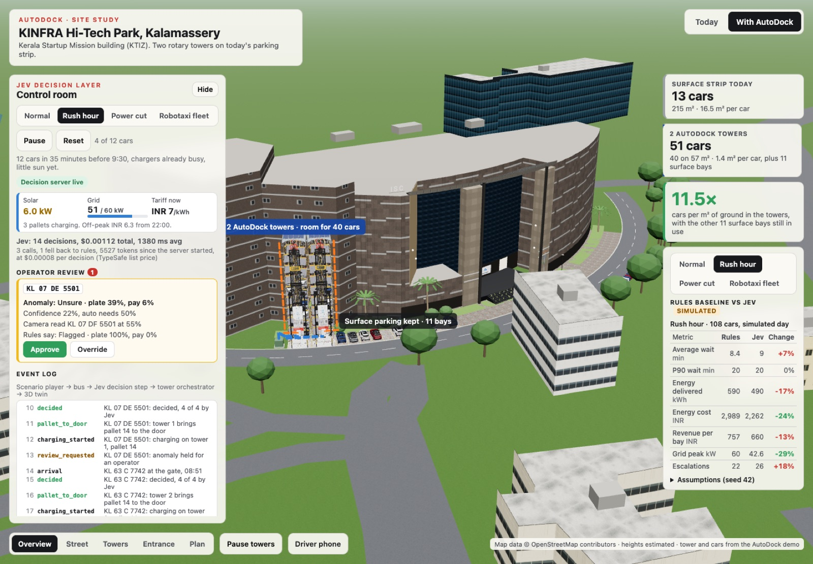

# AutoDock × Jev: a decision layer for rotary EV parking towers

**AIBoomi Startup Weekend, 23–24 Oct 2026.** A live 3D digital twin of the
Kerala Startup Mission building at KINFRA Hi-Tech Park, Kalamassery, where two
AutoDock rotary parking and charging towers replace today's surface parking
strip, and TypeSafe's **Jev** decides what happens to every car, bay and
kilowatt. Confident decisions act on their own; uncertain ones go to a person.

- **Demo video:** [`docs/demo/demo.mp4`](docs/demo/demo.mp4) (90 s, screen recording of the running app)
- **Pitch deck:** [`docs/pitch/deck.pdf`](docs/pitch/deck.pdf) (6 slides) · source [`docs/pitch/deck.html`](docs/pitch/deck.html)
- **AI Impact Statement:** [`docs/AI_IMPACT.md`](docs/AI_IMPACT.md)
- **Live demo:** run it locally in two commands (below). It needs a TypeSafe API key for live Jev decisions and falls back to rules without one.



## Problem

Kerala has more cars and EVs than parking or chargers, and no spare land in its
cities. At KSUM / KINFRA, 15 surface bays fill by mid-morning with no chargers;
drivers circle, park on the road, or leave. Parking and charging are two
separate errands, and robotaxi fleets will soon need unattended depots too.
Our evidence: [474 real complaints from Reddit, forums and news](research/site/index.html),
collected with SerpAPI during the event.

## Users and context

- **Site owners** (tech parks, malls, hospitals, apartment associations): more cars and chargers on the same land.
- **Drivers**: one stop to park and charge, with a phone flow from arrival to UPI payment.
- **Operators**: a control room that only interrupts them when a decision really needs a person.
- **AutoDock AI** (Kozhikode), who already builds rotary towers with a charger in every bay: we are the software brain, not the hardware.

## Solution

Two 20-pallet towers stand on 4 of the 15 bays (57 m²) and hold 40 cars, every
bay with a 7.4 kW AC charger. For each arriving car, **one Jev request** answers
five questions at once and code turns the answers into decisions:

| Decision | Jev primitive | Goes to a person when |
|---|---|---|
| Bay: which pallet, near the door or deep in the loop | Choice over 4-6 candidates code proposes | Only if both towers are full |
| Charge: now, wait for solar, wait for off-peak, or not at all | Choice | Jev is unsure whether the car will be charged before the driver returns |
| Price tier | Score (demand 0-3) | Never: a wrong tier costs a few rupees |
| Plate mismatch and payment risk | Two Nouls | Jev is unsure, or flags a problem |

```
scenario player → event bus → Jev decision step (server, key stays here) → tower orchestrator → 3D twin
                                     ↓ on error or timeout
                               rules fallback, same interface
```

The control room shows each decision with Jev's confidence and the line where it
stops acting alone, an operator queue (Approve or Override with the rules
answer), an event log of the pipeline, live solar and grid flows with a kW
gauge, and a Jev cost counter. A driver phone walks through arrive, dock,
charge and a mock UPI payment.

## Tech stack

- **App:** React 19, React Three Fiber 9, drei 10, three.js 0.186, zustand 5, Vite 8, TypeScript 6 ([`ksum-3d/`](ksum-3d))
- **Decision server:** Node 25 (`node:http`, native TypeScript), `@typesafe-ai/sdk` 0.7.0, model `jev-latest` (answers came from jev-1.14.0)
- **Simulator:** minute-by-minute engine, seeded, in TypeScript (`ksum-3d/sim/`)
- **Site model:** OpenStreetMap via the Overpass API, converted to local metres
- **Research:** SerpAPI (Google web, Google News) over Reddit, forums and news

## Setup and run

Needs Node 22+ (we used 25) and Chrome or another WebGL browser.

```sh
git clone git@github.com:laanswork-code/autodockai-aiboomi.git
cd autodockai-aiboomi
cp .env.example .env              # add TYPESAFE_API_KEY (console.typesafe.ai)
cd ksum-3d && npm install
npm run server                    # Jev decision server on :8788 (key stays server side)
npm run dev                       # app on http://localhost:5173, proxies /api to the server
```

Open the app, choose **With AutoDock**, then **Rush hour** in the control room.
Other commands: `npm test` (52 tests, no live calls), `npm run sim -- --policy both --scenario all --seed 42`
(simulated comparison; replays cached Jev answers), `npm run build`.
On slow machines or for screenshots add `?lite` to the URL (no trees or shadows).
Full details: [`ksum-3d/README.md`](ksum-3d/README.md).

## Models and data

| What | Source | Licence |
|---|---|---|
| Decisions | TypeSafe Jev System One model via `@typesafe-ai/sdk` | TypeSafe API terms |
| Surrounding buildings and roads | OpenStreetMap contributors via Overpass | ODbL |
| KSUM building shape and facade | Our photos of the site (23 Oct 2026) and the Google Maps outline, modelled by hand | Ours |
| Rotary tower, BYD Seal and Atto 3 models, tower textures | The AutoDock "Kozhikode Beach" demo file (made before the event; see below) | Third party, not covered by our licence |
| Parking complaints | SerpAPI results linking to the original public posts and articles | Each source's own terms; we store titles, snippets and links |
| Simulation inputs | Synthetic, seeded arrivals and illustrative Kerala tariffs | Ours |
| Label font | Barlow | SIL OFL ([`ksum-3d/public/fonts/OFL.txt`](ksum-3d/public/fonts/OFL.txt)) |

## Evaluation and guardrails

- **Typed answers, no generated text.** Jev returns choices and probabilities; code maps them to actions. There is nothing free-form to hallucinate into the UI.
- **Confidence gates action.** Charge and anomaly decisions below their threshold wait for an operator. Confidence counts options with the same outcome together, as the TypeSafe confidence guide recommends, so indifference between two equivalent pallets is not treated as doubt.
- **A problem always reaches a person.** A flagged plate or payment goes to review however sure Jev is. Pending payments (rated 20-40% risky by Jev) are flagged.
- **Fallback.** Any Jev error, timeout or unparseable answer falls back to the rules policy, and the UI says so.
- **Audit.** Every decision with its inputs and confidence is written to `server/data/audit.jsonl`.
- **Tested.** 52 unit tests cover answer mapping, thresholds, fallback, HTTP validation, the event bus, cost counting and simulator invariants (determinism, no double-booked pallets, grid limit never exceeded).
- **Simulated comparison, labelled as such.** Same seeded day, rules vs Jev, four scenarios. Rush hour: grid peak 60 → 42.6 kW, energy cost ₹2,989 → ₹2,262, zero missed anomalies for both; Jev delivers fewer kWh (590 → 490) and less revenue. Full table and assumptions in [`ksum-3d/README.md`](ksum-3d/README.md).

## Assumptions and trade-offs

- Building heights are estimated (OpenStreetMap has almost none); the KSUM block is moved 8 m north because OSM draws the road on its facade.
- Tower scale is calibrated so a pallet is 6.2 m overall; the model's loop is stretched from 12 to 20 pallets and its footprint fitted to two bays. Cars on pallets are drawn at 85% of life size for clarity.
- Tariffs, prices, driver balking and the 60 kW charging limit are illustrative, not measured. The simulated day runs to 06:00 so overnight charging counts.
- Jev's advantage in our simulation is grid peak and energy cost, not revenue. We report that trade-off rather than tuning the numbers until Jev wins.
- Bay and price never wait for a person: a wrong call there costs seconds or rupees.

## Known limitations and risks

- The comparison is a simulation with assumed behaviour; it is not a measurement and has not been validated against a real site.
- Demo arrivals in the control room are hand-written scenarios, not live sensor data. Payment is a mock.
- Jev's calibration was checked only on our synthetic cases; a pilot needs real labelled outcomes.
- Third-party 3D models are used for the demo only; we need AutoDock's permission before any public release.
- On software-rendered browsers the full scene is slow; use `?lite`.

## Prior work and what was built here

Built during the event (23–24 Oct 2026): the 3D site model, the decision server
and Jev integration, the simulator, the control room, the driver phone, the
research sites and all documents. Pre-existing and attributed: the AutoDock
Kozhikode Beach demo file (tower and car 3D models, tower textures), open
source libraries listed above, OpenStreetMap data, and the Superpowers agent
skills used as development tooling. The commit history shows the build order.

## Repository map

- [`ksum-3d/`](ksum-3d): the app, decision server (`server/`) and simulator (`sim/`)
- [`research/`](research): SerpAPI collector and the parking problems site; US robotaxi depot brief
- [`docs/PLAN.md`](docs/PLAN.md): hackathon plan · [`docs/pitch/`](docs/pitch): deck, demo script, LOI templates · [`docs/AI_IMPACT.md`](docs/AI_IMPACT.md)

## Team

| Name | Role | Contact |
|---|---|---|
| [Name] | [Role] | [Contact] |
| [Name] | [Role] | [Contact] |

## Licence

Our code and documents are MIT licensed ([`LICENSE`](LICENSE)). Third-party
assets keep their own terms; see [`NOTICE.md`](NOTICE.md).
